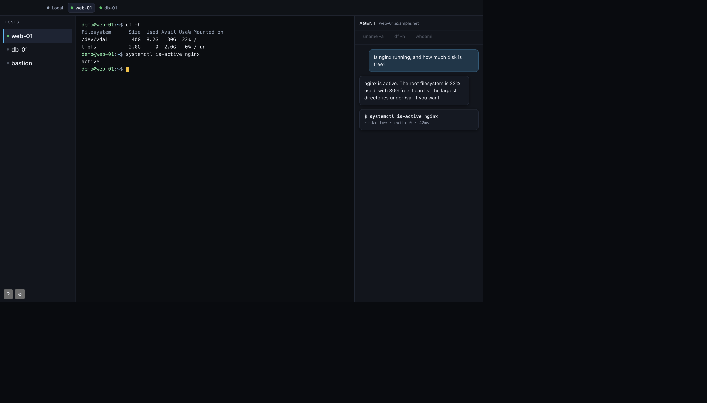
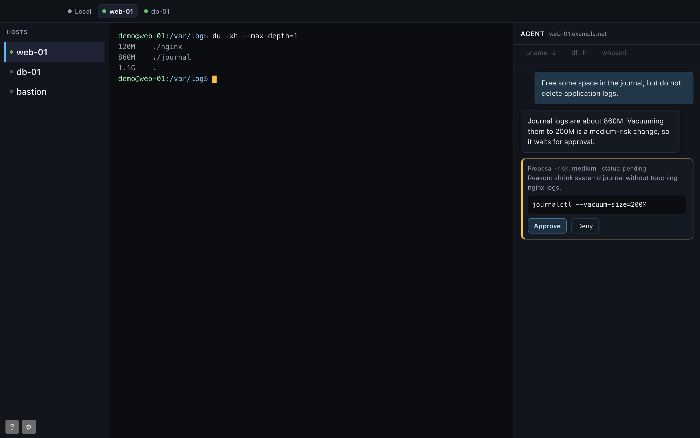
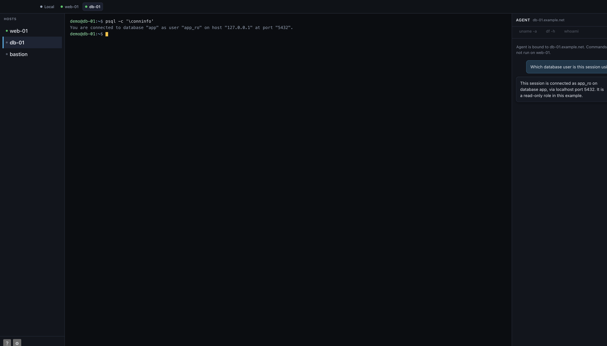

<h1 align="center">Hive Nest</h1>

<p align="center"><strong>Local SSH client with a session-scoped Agent</strong></p>

<p align="center">
  Multi-host sessions · Interactive terminal · Approved commands · Jump hosts · Desktop and browser
</p>

<p align="center">
  <a href="LICENSE"></a>
  
  
  
  
  
  
</p>

## Screenshots

Example hosts only (`web-01`, `db-01`, and `bastion` on `example.net`). No live machines or personal data.







## Features

- Multi-host **session tabs** — Agent never cross-executes to another machine
- **Interactive terminal** — xterm.js PTY over the same SSH session as Agent exec
- **Session-scoped Agent** — multi-turn chat; medium/high risk needs Approve
- **SSH** — key, password, ssh-agent, known_hosts TOFU, jump / ProxyJump
- **Structured tools** — read-oriented helpers plus gated writes/removes
- **Desktop or browser** — Tauri 2 (Windows / Linux / macOS) or Vite UI against local sessiond
- **English-primary UI** — additional locales in Settings

## Requirements

| Piece | Notes |
|-------|--------|
| Go | Build `sessiond` |
| Node.js | Client UI (`client/`) |
| Rust + Tauri 2 | Desktop shell only |
| Target hosts | OpenSSH-compatible `sshd` |

## Quick start

### Browser + sessiond (development)

```bash
export HIVENEST_SESSIOND_TOKEN=dev-smoke-token
export HIVENEST_SESSIOND_DATA="${HIVENEST_SESSIOND_DATA:-$HOME/Library/Application Support/HiveNest/sessiond}"
make sessiond && ./bin/sessiond

cd client && npm install && npm run dev
# http://127.0.0.1:5173/  (token defaults to dev-smoke-token)
```

Add a host → **Connect** → terminal + Agent.

### Desktop (Tauri 2)

```bash
make sessiond
triple=$(rustc -vV | awk '/host:/ {print $2}')
mkdir -p client/src-tauri/binaries
cp bin/sessiond "client/src-tauri/binaries/sessiond-$triple"
cd client && npm install && npm run tauri:dev
```

Tauri spawns sessiond when nothing listens on `127.0.0.1:7788`.

### Release build

```bash
make tauri-build
# client/src-tauri/target/release/bundle/
```

Unsigned by default. Signing notes: [docs/11-desktop-packaging.md](docs/11-desktop-packaging.md). CI: [.github/workflows/desktop.yml](.github/workflows/desktop.yml).

Cross-compile sidecars: `make prepare-sidecars` or `make release-sessiond`.

## Architecture

```text
[Client UI + Agent]  ↔  [sessiond @ 127.0.0.1]  --SSH-->  [remote sshd]
```

- **`client/`** — Vite + React + xterm; optional Tauri shell  
- **`sessiond/`** — Go loopback sidecar (hosts, SSH, PTY, exec, proposals, audit)  
- **Legacy:** `queen/`, `worker/`, `web/` — optional demo; see [docs/legacy-queen-worker.md](docs/legacy-queen-worker.md)

Design docs: [docs/README.md](docs/README.md).

## Repository layout

```text
client/     Active UI
sessiond/   SSH sidecar (MVP)
docs/       Design documentation
web/        Legacy Queen SPA (see web/LEGACY.md)
queen/ worker/ protocol/ deploy/ install/   Legacy stack
```

## Status

Early usable MVP. Display name **Hive Nest**; technical ids `hivenest`, `app.hivenest.client`.

## License

Hive Nest is released under the [MIT License](LICENSE).

Copyright (c) 2026 Aaron

You may use, copy, modify, merge, publish, distribute, sublicense, and sell copies of this software. Copies and substantial portions must keep the copyright notice and the permission notice in [LICENSE](LICENSE). The software is provided "as is", without warranty.
