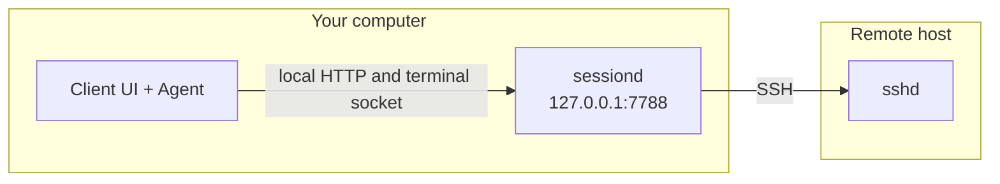
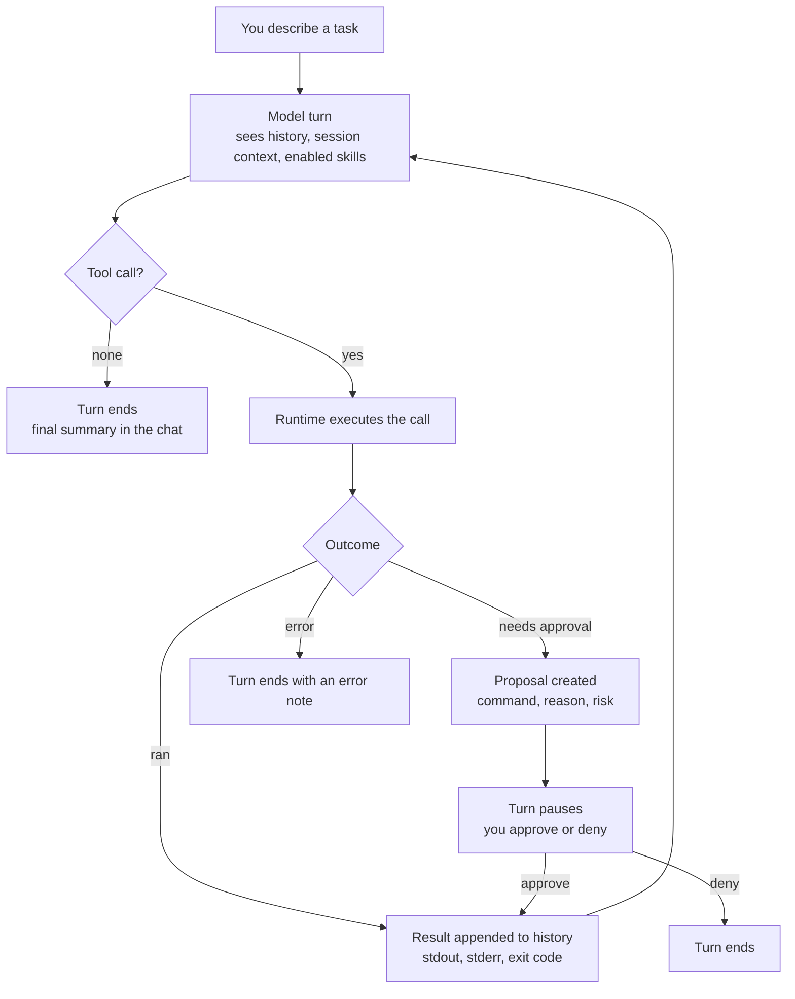
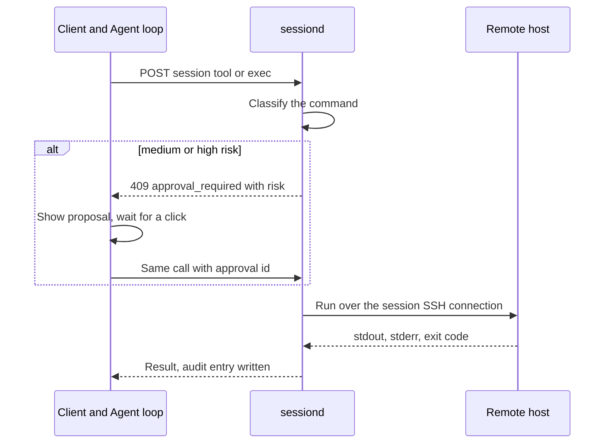

<h1 align="center">Hive Nest</h1>

<p align="center"><strong>Local SSH client with a session-scoped Agent</strong></p>

<p align="center">
  Multi-host sessions · Interactive terminal · Approved commands · Jump hosts · Desktop and browser
</p>

<p align="center">
  <a href="LICENSE"></a>
  
  
  
  
  
  
</p>

Hive Nest is a calm place to run SSH. Every tab is one host, with a real terminal on the left and an Agent beside it that works on that same session only — it never reaches across to another machine. Anything that could hurt, like writing files or removing them, waits for your approval and stays in view.

No agent runs on your servers. A small local sidecar, `sessiond`, holds the connections, so remote hosts only need OpenSSH.

## Screenshots

Example hosts only (`web-01`, `db-01`, and `bastion` on `example.net`). No live machines or personal data.


## Why Hive Nest

**One host per tab.** Open several servers at once. Each tab keeps its own terminal and its own Agent, so a conversation about one machine can never touch another.

**A terminal that is actually a terminal.** A real PTY over `xterm.js`, sharing the same SSH session the Agent uses. What you read in the chat is what happened in the shell.

**Approval instead of blind trust.** The Agent proposes a command with a reason and a risk level. Read-only work at low risk can run straight away; anything that writes, deletes, or otherwise changes state waits for your click.

**SSH without the archaeology.** Keys, passwords, and `ssh-agent` all work, with TOFU host-key checks and jump chains or `ProxyJump` for bastioned networks.

**Runs where you already work.** A Tauri desktop app on macOS, Linux, and Windows, or the same UI in a browser against a local `sessiond`. Settings ship in English, 简体中文, 繁體中文, Español, Français, Deutsch, Português, Українська, 日本語, and 한국어.

**Local by default.** Tokens and API keys stay on your machine, in the OS keychain or encrypted local storage. Hive Nest does not phone home.

## Requirements

| Piece | Notes |
|-------|--------|
| Go | Build `sessiond` |
| Node.js | Client UI (`client/`) |
| Rust + Tauri 2 | Desktop shell only |
| Target hosts | OpenSSH-compatible `sshd` |

## Quick start

### Browser + sessiond (development)

```bash
export HIVENEST_SESSIOND_TOKEN=dev-smoke-token
export HIVENEST_SESSIOND_DATA="${HIVENEST_SESSIOND_DATA:-$HOME/Library/Application Support/HiveNest/sessiond}"
make sessiond && ./bin/sessiond

cd client && npm install && npm run dev
# http://127.0.0.1:5173/  (token defaults to dev-smoke-token)
```

Add a host → **Connect** → terminal + Agent.

### Desktop (Tauri 2)

```bash
make sessiond
triple=$(rustc -vV | awk '/host:/ {print $2}')
mkdir -p client/src-tauri/binaries
cp bin/sessiond "client/src-tauri/binaries/sessiond-$triple"
cd client && npm install && npm run tauri:dev
```

Tauri spawns sessiond when nothing listens on `127.0.0.1:7788`.

### Release build

```bash
make tauri-build
# client/src-tauri/target/release/bundle/
```

Unsigned by default. Signing notes: [docs/11-desktop-packaging.md](docs/11-desktop-packaging.md). CI: [.github/workflows/desktop.yml](.github/workflows/desktop.yml).

Cross-compile sidecars: `make prepare-sidecars` or `make release-sessiond`.

## Architecture

The app on your computer never opens SSH itself. It talks only to `sessiond` on this machine. `sessiond` is the process that connects to the remote host.



- **`client/`** — the UI: Vite, React, and xterm, wrapped in an optional Tauri shell
- **`sessiond/`** — the local Go sidecar: hosts, SSH, PTY, exec, proposals, and the audit trail
- **Legacy** — `queen/`, `worker/`, and `web/` keep the older dial-out demo around; see [docs/legacy-queen-worker.md](docs/legacy-queen-worker.md)

Deeper notes live in [docs/README.md](docs/README.md).

## How the Agent works

The Agent is a tool-use loop, not a chat window that prints commands. A turn is a bounded conversation between three parties: the model, the loop runtime in the client, and `sessiond` on the far side of the SSH connection.

### The loop



Each pass is one step, capped at 24 steps per turn (`DEFAULT_AGENT_MAX_STEPS`). The cap exists so a model that keeps looping cannot run up cost or keep touching a server indefinitely. Stop ends the turn immediately, and the loop checks for it before every step and again after each result.

### Two wire formats, one loop

If the current provider speaks the Anthropic Messages API, tool calls arrive as native `tool_use` blocks. The transcript keeps the full `tool_use` / `tool_result` pairing, which is what the API expects on the next call. Every other provider uses a JSON protocol: the model is asked for a structured object naming a command or tool, and the result is appended to a plain `[user, assistant]` history.

Both paths converge on the same `SuggestCommandResult`, so the loop, the risk gate, and the UI never branch on provider.

### The tool surface

| Tool | Risk | Notes |
|---|---|---|
| `list_files`, `read_file`, `stat_path`, `disk_free`, `list_processes` | low | Read-only, run without asking |
| `write_file`, `mkdir` | medium | Waits for approval |
| `remove_file`, `rmdir` | high | Waits for approval |
| `run_shell_command` | medium | Escape hatch when no tool fits |
| MCP tools | discovered | Mutating or unknown tools are treated as medium |

Structured tools are the default. `sessiond` maps each one to a single shell command with the path quoted and validated first, so the model never gets to hand-assemble a `rm` invocation. Shell is there for the cases the tool surface does not cover, not as the primary path.

### Why approval lives on the server

Risk is classified twice, deliberately. The client maps tool names to a level for display, and `sessiond` independently classifies the command string with regexes for the things that actually cause damage: `rm -rf`, `mkfs`, `dd if=`, writes into `/etc`, piping a download into a shell, and service stops or package removals. If `sessiond` disagrees with the client, `sessiond` wins and returns `409 approval_required`.



That asymmetry matters. A bug in the UI cannot skip the gate, because the gate is not in the UI. Every decision, whether the user clicked approve or the command simply ran, is written to the audit log with the actor recorded as `agent` rather than `user`.

### Sessions are the boundary

The Agent is handed exactly one `SessionInfo`. It has no host list and no way to name a different machine, so "run this on the database box instead" is not expressible. A new tab is a new session with its own history, and the saved chats are keyed per host profile. Closing a tab ends its Agent conversation; the transcript stays on disk for review.

Skills and MCP extend the prompt, never the permissions. An enabled skill can tell the model to prefer `list_files`, and an MCP server can expose new tools, but both still land in the same loop and the same risk gate.

## Repository layout

```text
client/     Active UI
sessiond/   SSH sidecar (MVP)
docs/       Design documentation
web/        Legacy Queen SPA (see web/LEGACY.md)
queen/ worker/ protocol/ deploy/ install/   Legacy stack
```

## Status

An early but usable MVP. The product is called **Hive Nest**; technical ids stay `hivenest` and `app.hivenest.client`.

## License

Hive Nest is released under the [MIT License](LICENSE).

Copyright (c) 2026 Aaron

You may use, copy, modify, merge, publish, distribute, sublicense, and sell copies of this software. Copies and substantial portions must keep the copyright notice and the permission notice in [LICENSE](LICENSE). The software is provided "as is", without warranty.
