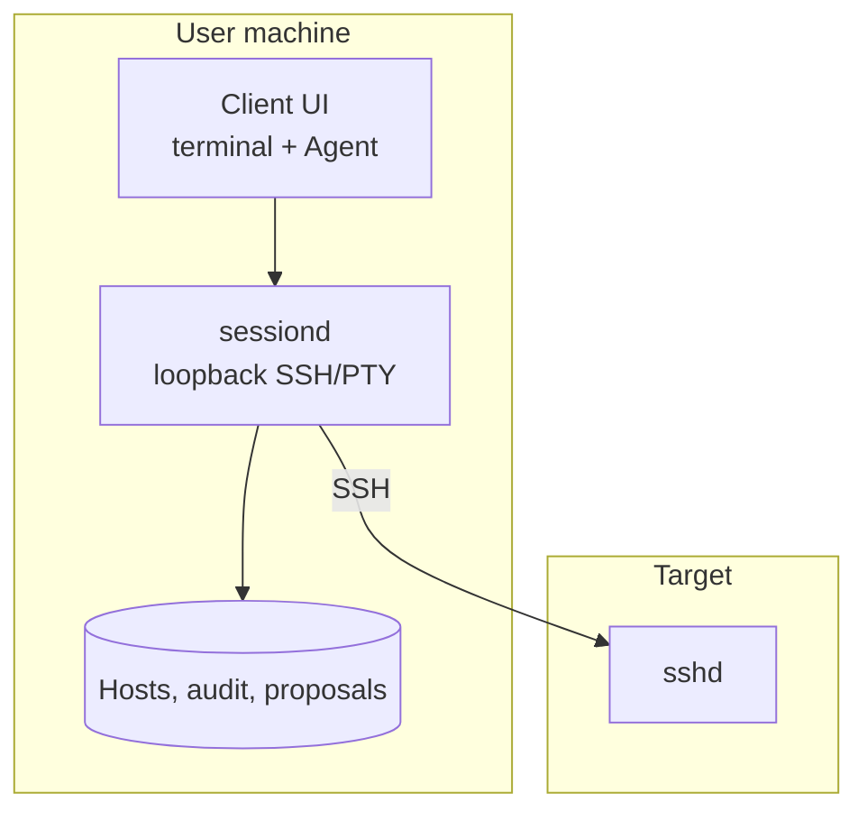
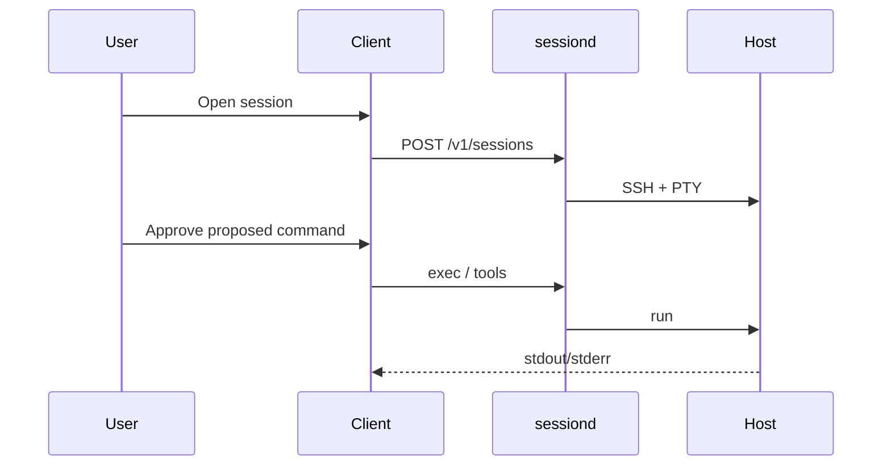

# Architecture

See also [10-iterm-client.md](./10-iterm-client.md) for product UX and [sessiond/README.md](../sessiond/README.md) for the HTTP/WebSocket API.

## Components

| Piece | Role |
|-------|------|
| **Client UI** (`client/`) | Host list, xterm PTY, Agent panel, settings, approve/deny |
| **sessiond** (`sessiond/`) | Host profiles, SSH dial, PTY WebSocket, exec, structured tools, proposal gate, audit |
| **Agent runtime** (in client) | LLM + tool loop; calls sessiond only; scoped to `session_id` |
| **Remote sshd** | Only required service on the target for MVP |

Optional later: lightweight **host agent** on targets, **cloud sync** for profiles — neither blocks MVP.

## Trust model

1. User trusts the local client; SSH identity stays on the machine (agent or key files).
2. Agent is not a hidden admin channel: proposals and exec output are visible.
3. Default **approve** for medium/high risk; read-only tools may auto-run per policy.
4. **sessiond** binds to loopback and requires a bearer token.
5. Remote stdout/stderr/files are **untrusted** (prompt-injection aware).

**Enrollment (MVP):** add a host profile and SSH connect. No Worker bootstrap or Queen registration.

## Session flow (Agent exec)

## Local data (conceptual)

- **Host profile:** id, name, host, port, user, auth, jump/proxy settings
- **Session:** id, host_id, remote label, PTY flag
- **Proposal:** command, reason, risk, status
- **Audit:** host, session, actor, command, exit, timestamp

## Deployment modes

| Mode | Use |
|------|-----|
| Tauri app | Product; spawns sidecar if `:7788` is free |
| Browser + sessiond | Development |
| Queen/Worker Docker | Legacy demo only |

## Legacy architecture

Pre-2026 control-plane design (Queen ↔ outbound Worker): [legacy-queen-worker.md](./legacy-queen-worker.md).
